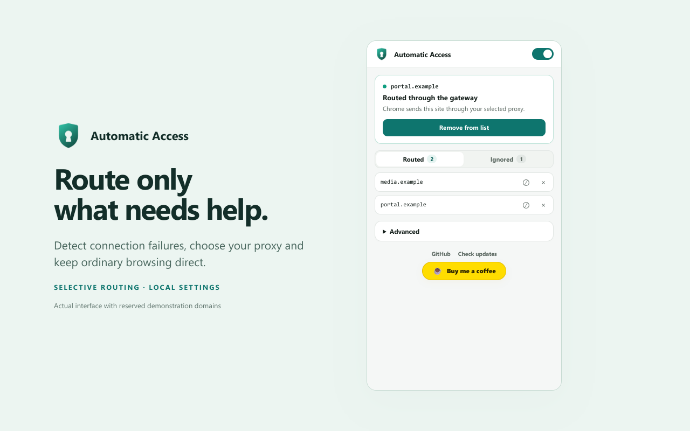
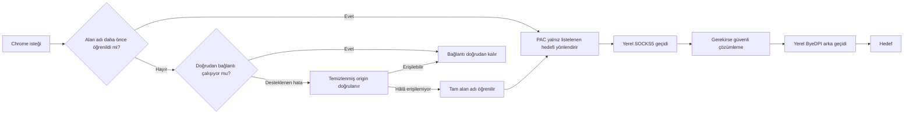

[English](README.md) | **Türkçe**

# Otomatik Erişim

Bağlantı hatası yaşayan hedefleri öğrenip yalnız açıkça listelenen alan adlarını kullanıcının bilgisayarındaki yerel SOCKS5 uyumluluk geçidine yönlendiren Manifest V3 Chrome eklentisi.

Güncel sürüm: **4.17.1**



## Bu proje neden önemli?

Erişim hataları çoğu zaman yerel veya ağa özgüdür; buna karşılık yaygın çözümler bütün bağlantıları VPN'e yönlendirmek, cihazın DNS yapılandırmasını değiştirmek ya da tek bir DPI uyumluluk profilini geniş kapsamda uygulamaktır. Bu yaklaşımlar, çözümden etkilenmesi gerekmeyen trafiği de kapsayarak ilgisiz gecikme, gizlilik veya uyumluluk sorunları oluşturabilir.

Otomatik Erişim daha dar bir yol izler: Chrome'daki desteklenen bağlantı hatalarını gözlemler, tam sayfa adresini göndermeden origin'i doğrular ve yalnız etkilenen hedefin rotasını değiştirir. Ana sayfa öğrenildiğinde geleneksel `www` eş adı da listelenir. Diğer alt alanlar için ayrıca hata kanıtı veya elle seçim gerekir; joker kapsam oluşturulmaz. Çalışan diğer bağlantılar normal yolunda kalır.

## Nasıl çalışır?



Eklenti karar katmanıdır; yerel yardımcı ise taşıma katmanıdır. Eklenti normal trafiği yardımcıya göndermez ve yardımcı HTTPS içeriğinin şifresi çözülmüş hâlini göremez.

## Diğer yöntemlerden farkı

| Yaklaşım | Tipik kapsam | Neyi değiştirir? | Hataya göre otomatik seçim |
| --- | --- | --- | --- |
| **Otomatik Erişim** | Chrome'da açıkça listelenen hedefler | Dar kapsamlı PAC ile yerel uyumluluk yoluna yönlendirme | Evet; hata eşikleri ve temizlenmiş doğrudan origin kontrolüyle |
| **Klasik VPN** | Genellikle cihazın veya seçilen uygulamanın tüm trafiği | Ağ rotası ve çoğunlukla görünen çıkış IP'si/konumu | Hayır; hedefin ihtiyacı olmasa da trafik VPN politikasını izler |
| **Özel DNS / şifreli DNS** | Birçok veya bütün alan adının çözümlemesi | DNS sorgularını hangi çözümleyicinin yanıtladığı | Hayır; DNS tek başına taşıma katmanındaki DPI müdahalesini düzeltemez |
| **Tek başına ByeDPI** | Yerel proxy'ye elle gönderilen veya harici yapılandırmanın kapsadığı trafik | Paket düzeyindeki bağlantı davranışı | Tek başına hayır; hedef seçimi ve tarayıcı kurtarması ayrıca yapılandırılmalıdır |

Otomatik Erişim bu araçların her senaryodaki yerine geçmez. Farklı bir çıkış ağı gerektiğinde VPN, çözümleyici gizliliği veya DNS arızalarında özel DNS, düşük seviyeli elle kontrol için bağımsız ByeDPI daha uygun olabilir. Bu proje; normal gezinmenin hiç değişmemesi, yalnız doğrulanmış biçimde başarısız olan Chrome hedeflerinin yerel uyumluluk yolunu kullanması gereken daha dar senaryoya odaklanır.

## Temel davranış

- Normal çalışan bağlantılar doğrudan kalır.
- Hata eşikleri hata türüne bağlıdır; DNS hatası bir gözlem ve sınırlı origin kontrolünden sonra öğrenilebilir.
- DNS çözümleme hatası yaşayan ana sayfalar ve harici çerçeveler öğrenilebilir. Tekrarlanan sertifika otoritesi hataları da seçici yeniden denemeyi tetikleyebilir; ancak sertifika doğrulaması hiçbir zaman atlanmaz.
- Başarısız ana sayfa, temizlenmiş origin kontrolü de başarısızsa öğrenilip yeniden denenir. Ana sayfada tekrarlanan bağlantı sıfırlanması, kapanması, zaman aşımı veya taşıma protokolü hataları, küçük kontrol isteği yanıt alsa bile geçici proxy rotasını tetikleyebilir; başarılı gezinme hata kanıtını temizler. Gerçek ağ hatası vermeyen yavaş sayfa doğrudan kalır.
- Tarayıcı sekmesi ağ hatası üretmeden olağandan uzun süre yükleniyor kalırsa eklenti rotayı değiştirmeden yavaş sayfa teşhisi gösterir ve isteğe bağlı genel durum kontrolünü sunar.
- Bir sayfa yönlendirildikten sonra o sayfanın başlattığı ve DNS hatası ya da zaman aşımı yaşayan bağımlılıklar doğrudan origin probu da başarısızsa öğrenilebilir; ilgisiz sayfalar bu genişletilmiş bağımlılık işlemini tetikleyemez.
- Doğrulama isteği tam adresi tekrarlamaz; kullanıcı bilgisi, yol, sorgu ve fragment kaldırılarak yalnız origin kökü çerezsiz sınanır.
- Kontroller alan adı bazında yürütülür. Bir hedefteki gecikme diğer alan adlarını bekletmez ve aynı anda en fazla üç doğrulama yapılır.
- Ana hedef kurtarılırken geç başlayan sayfa bağımlılıkları, ana belge tamamlanmış olsa bile sınırlı bir sakinleşme penceresinde toplanır; gerekirse kontrollü olarak yeniden denenir ve yenileme döngüsü sınırlandırılır.
- Protokol hataları sınırlı origin kontrolleri kullanır. Yönlendirilmiş sayfadaki tekrarlanan genel WebSocket hatası geçici bağımlılık rotası oluşturabilir; HTTP başarısı WebSocket başarısı sayılmaz.
- Yerel geçit bağlantı hazırlığı süreyle sınırlıdır. Yalnız loopback üzerinde çalışan sağlık kontrolü, durmuş yerel yardımcı ile çalışan geçit üzerinden de erişilemeyen hedefi ayırır; böylece yanıltıcı kurulum uyarıları ve gereksiz yenilemeler önlenir. Başarıyla açılan sayfanın kalan kaynakları yüklenirken proxy yapılandırması sabit tutulur.
- İlk doğrudan bağlantı on iki saniye boyunca sonuçlanmazsa araç çubuğu rozeti ve otomatik kapanan tek bir bildirim, algılamanın sürdüğünü açıklar. Sayfa tamamlandığında veya Chrome hata bildirdiğinde mesaj temizlenir; bu uyarı tek başına alan adını yönlendirmez ya da öğrenmez.
- Genel durum yoklaması sınırlı toplam süre bütçesinin tamamını kullanır; yavaş ölçümler sabit yoklama sayısı yüzünden erken kesilmez. Kullanıcının başlattığı kıtalar arası kontrol olası genel kesinti bulursa kaldırılan rota, hâlâ hata veren açık sekme tarafından on beş dakika boyunca otomatik olarak yeniden öğrenilmez; geçici bekleme kendiliğinden sona ererken sonuç görünür kalır.
- Yerel geçit uzun süre boşta kalan oturumlarda kararlı çalışmayı sürdürür.
- Kurallar yalnız listelenen tam alan adlarına uygulanır; ana sayfanın `www` eş adı ayrıca listelenir. Diğer alt alanlar ayrı kanıt ister. Yoksayılan hedef ve alt alanları doğrudan kalır.
- Doğrudan origin kontrolleri en fazla 2,5 saniye, Chrome zaten DNS çözümleme hatası bildirdiyse 1,5 saniye sürer. Yönlendirilmiş bir sayfanın bağımlılık DNS hatası ve eşikle doğrulanmış WebSocket hatası için ilgisiz HTTP kök kontrolü tekrarlanmaz. Bu rotalar yine geçici kabul edilir ve mevcut kurtarma kurallarına tabidir.
- PAC uygulaması tamamlanmadan kurtarma başlamaz. Bu nedenle ana sayfa yeniden yükleme devri 1,5 saniye yerine 250 ms'dir; bağımlılık keşifleri eşzamanlı hataları toplamak için 500 ms bekler. Yeni öğrenilen rotaya 60 saniyelik koruma süresi verilir; aynı gezinmedeki paralel hatalar rotayı hemen geri sökemez.
- Yeni öğrenilen otomatik rota, öğrenmeyi tetikleyen istek türü geçit üzerinden başarılı olana kadar geçicidir. Bu nedenle ana sayfanın HTTP başarısı bir WebSocket rotasını doğrulayamaz. Doğrulanmamış rota aynı türde üç ayrı gezinmede başarısız olursa tam günlük gözlemden sonra kaldırılır; geçit arızaları ve kurtarma yenilemeleri sayılmaz, `www` ile kök alan adı aynı sağlık kaydını paylaşır.
- Sağlıklı yerel geçit otomatik öğrenilmiş hedefe erişemezse eklenti bir kez, sınırlandırılmış doğrudan yol denemesi yapar. Aynı türde doğrudan başarı otomatik rotayı kaldırır; başarısızlık rotayı geri yükler. On dakikalık bekleme süresi rota ve yenileme döngüsünü engeller.
- Kullanıcının açıkça seçtiği rotalar otomatik doğrudan kurtarma ile kaldırılmaz. Eski sürümlerin oluşturduğu rotalarda güvenilir kaynak bilgisi bulunmadığından, kullanıcı kaldırıp yeniden ekleyene kadar bunlar da güvenli biçimde manuel rota gibi korunur.
- Özel, yerel ve link-local IPv4/IPv6 adresleri yönlendirme dışında tutulur.
- Öğrenilen ve yoksayılan alan adları yalnız `chrome.storage.local` içinde saklanır.
- Eklenti ve yardımcı; tarayıcı, adaptör, sistem veya modem DNS yapılandırmasını değiştirmez.
- Araç çubuğu ikonu doğrudan ve başarılı bağlantıda yazısız kalır. Yerel geçit kullanıldığında mavi `↗`, yeni rota öğrenildiğinde camgöbeği `+`, süren kontrolde turuncu `?`, erişim veya geçit hatasında kırmızı `!`, kapalı durumda gri `×` gösterilir. Kısa işaretler ikonu kapatmaz; durum hem ana sayfanın sonucunu hem de sekmedeki yönlendirilmiş bağımlılıkları izler.

Paketle gelen yerel geçit VPN değildir; görünen çıkış IP'sini veya ülkeyi değiştirmez. Kullanıcının seçtiği uzak proxy çıkış IP'sini ve konumunu değiştirebilir. Yalnız kullanıcının erişim yetkisi bulunan hedeflerde ve yürürlükteki kurallara uygun kullanılmalıdır.

## Arayüz

Açılır pencere, üzerinde açıldığı sekmeye göre kurgulanmıştır. Tek bir kart o alan adını gösterir, ona ne olduğunu söyler ve yalnız geçerli olan eylemi sunar: geçide al, listeden çıkar veya yoksaymayı kaldır. Tanı kartı yalnız o sekmede gerçekten bir sorun varken altında belirir.

İki hedef listesi tek bir segment denetimini paylaşır; böylece uzun bir yönlendirme listesi yoksayılanları ekrandan itmez. Satır eylemleri kendi erişilebilir adlarını taşıyan simge düğmeleridir: eğik çizgili daire hedefi yoksayılanlara taşır, çarpı şimdilik kaldırır, ok ise yoksayılan bir hedefi geri getirir.

Günlük akışın dışında kalan her şey tek bir kapalı **Gelişmiş** bölümündedir: geçit seçimi, kurulu sürüm, kurtarma eylemleri ve debug kaydı. Kullanıcı projenin paketle gelen yerel SOCKS5 geçidini veya kendi kimlik doğrulaması gerektirmeyen SOCKS5, SOCKS4, HTTP ya da HTTPS proxy'sini seçebilir. Seçilen proxy yine yalnız öğrenilen alan adlarında kullanılır; normal trafik doğrudan kalır.

Yeni kurulumda eklenti anahtarı açık gelir; ancak kullanıcı paketle gelen yerel geçidi veya özel bir proxy'yi açıkça seçene kadar yönlendirme ve otomatik öğrenme güvenli biçimde bekler. Tek seferlik kurulum sekmesi ve Chrome bildirimi, kullanıcının popup'ı kendiliğinden keşfetmesini beklemeden bu gerekliliği görünür kılar. Kurulum ekranı ve Gelişmiş ayarlar; yapılandırılmamış proxy'yi, çalışan yerel geçidi, eksik/durmuş yerel geçidi, kaydedilmiş özel proxy'yi ve Chrome proxy denetimi çakışmasını birbirinden ayırır. Başarılı yerel sağlık denetimi kurulumun tamamlandığını açıkça söyler ve sekmeyi kapatma eylemi sunar; yerel seçenek yanında kurma ve kaldırma yönergeleri görünür kalır. Özel uç noktanın kaydedildiği, fakat gerçek bağlantının ilk yönlendirilen istekte doğrulanacağı dürüstçe belirtilir. Onboarding kapatılırsa ilk anlamlı ana sayfa bağlantı hatasında bir kurulum hatırlatması daha gösterilir; sonraki hatırlatmalar altı saatlik bekleme süresiyle sınırlandırılır.

Alt bölüm kaynak depoya ve en yeni GitHub sürümüne bağlantı verir. Yerel klasörden yapılan güncellemede Chrome kısa süre eski service worker'ı tutarsa **Eklentiyi yeniden yükle** eylemi, eklentiyi kaldırmadan ve listeleri kaybetmeden yeni kodu etkinleştirir.

Açılır pencere tarayıcının açık veya koyu temasını izler. Her denetim klavye odak halkası çizer, aç/kapa anahtarı erişilebilir bir ad taşır ve durum mesajları canlı bölge üzerinden duyurulur.

## Kurulum

> Şu anda Windows ve Google Chrome desteklenir.

1. Depoyu indirin veya klonlayın.
2. Chrome'da `chrome://extensions` sayfasını açın.
3. **Geliştirici modu**nu açın ve **Paketlenmemiş öğe yükle** ile proje klasörünü seçin.
4. `helper/install.cmd` dosyasını **Yönetici olarak çalıştır** seçeneğiyle bir kez çalıştırın.
5. Eklenti kartındaki yenile simgesine basıp popup anahtarını etkinleştirin.

Yönetici izni yalnız Windows hizmetinin kurulması ve kaldırılması için gerekir. Eklenti yenileme veya ayar değişikliği PowerShell, komut penceresi ya da UAC istemi başlatmaz.

## Güncelleme

1. Depo dosyalarını güncelleyin.
2. Popup içindeki Gelişmiş bölümünden **Eklentiyi yeniden yükle** seçeneğini kullanın veya `chrome://extensions` içindeki eklenti kartının yenile simgesine basın.
3. `helper/` içeriği değişmişse `helper/install.cmd` dosyasını yeniden çalıştırın. Kurucu, güncel hizmeti yenilemeden önce yalnız projeye ait eski ağ bileşenlerini güvenle temizler.

## Kaldırma

1. Eklentiyi Chrome'dan kaldırın.
2. Yerel Windows geçidini kurduysanız `helper/uninstall.cmd` dosyasını yönetici olarak çalıştırın. Eklentiyi kaldırmak Windows hizmetlerini kaldırmaz. Kendi proxy'nizi kullanıyorsanız bu adım gerekmez.

Yalnız yardımcıyı kaldırıp eklentiyi tutacaksanız önce anahtarı kapatın veya başka proxy kaydedin. Çıkarılan proje klasörünü sildiyseniz kaldırıcıyı almak için GitHub kaynak/yardımcı paketini yeniden indirip çıkarın. Hizmet dosyalarını elle silmeyin.

Kaldırıcı yalnız bu projeye ait yerel bileşenleri kaldırır; adaptör DNS ayarını veya başka sistem ağ ayarlarını değiştirmez. İşlem doğrulanamazsa başarı mesajı yerine hata döndürür.

## İzinler

- `webRequest` ve HTTP/HTTPS/WS/WSS erişimi: desteklenen bağlantı hatalarını ve başarılı ana sayfa yanıtlarını algılamak.
- `proxy`: yalnız öğrenilen alan adlarına, paketle gelen yerel geçit veya kullanıcının seçtiği özel proxy üzerinden PAC yönlendirmesi uygulamak.
- `storage`: ayarlar ile öğrenilen, yoksayılan ve isteğe bağlı teşhis kayıtlarını cihazda saklamak.
- `activeTab`: popup açıldığında etkin sekmenin alan adını göstermek ve kullanıcı işlemini o sekmeyle ilişkilendirmek.
- `notifications`: yeni öğrenilen hedefi ve kullanıcı tarafından başlatılan durum kontrolü sonucunu bildirmek.
- `scripting`: otomatik öğrenilen harici iframe'i üst sayfayı yenilemeden tekrar yüklemek.

Eklenti uzaktan JavaScript çalıştırmaz, sayfa içeriği toplamaz, HTTPS şifresini çözmez ve özel sertifika kurmaz.

## Yerel yardımcı

Paketle gelen yerel geçit yalnız `127.0.0.1:1080` üzerinde dinler. İlk kurulumda yerel veya özel proxy açıkça seçilmelidir. Uyumlu bir proxy işleten kullanıcı Gelişmiş ayarlardan kimlik doğrulaması gerektirmeyen SOCKS5, SOCKS4, HTTP veya HTTPS uç noktası seçebilir; özel proxy bilgileri `chrome.storage.local` içinde kalır ve doğrudan trafik bu uç noktaya gönderilmez. Yerel yardımcının yönlendirdiği alan adlarında kimliği doğrulanan şifreli DNS cevabı önceliklidir; her sağlayıcı ayrı süre sınırıyla denenir ve biri engellendiğinde bağlantı bütçesinin tamamını tüketmeden sıradakine geçilir. Şifreli çözümleme kullanılabilir bir adres üretemezse mevcut sistem çözümleyicisine geri dönülür. Doğrudan IP istekleri değişmez. Çözülen IP adresleri `127.0.0.1:1081` üzerindeki ByeDPI arka geçidine verilir; TLS doğrulaması Chrome ile hedef arasında uçtan uca kalır ve hiçbir zaman kapatılmaz. İki Windows hizmeti de kısıtlı `LocalService` hesabıyla, bağımlılık sıralaması, otomatik başlangıç ve kontrollü yeniden başlatma politikalarıyla çalışır. Normal ve yönlendirilmemiş trafik cihazın mevcut DNS'ini ve doğrudan yolunu kullanmayı sürdürür. Geçit henüz başlıyorsa yönlendirilmiş ana sayfalar kısa aralıklarla ve sabit bir sınırla yeniden denenir. Kurulum:

- paketlenen iki ikilinin SHA-256 değerlerini kopyalamadan önce ve sonra doğrular;
- klasörü yalnız SYSTEM, yöneticiler ve hizmet hesabının erişebileceği ACL ile sınırlar;
- DNS/NRPT kuralı, kayıt defteri girdisi veya zamanlanmış görev oluşturmaz;
- yalnız eski DNS tabanlı sürümlerin kesin olarak tanımlanmış kalıntılarını kaldırır ve devam etmeden önce sonucu doğrular.

Kaynak, derleme, sürüm, hash ve lisans bilgileri `helper/bin/SOURCE.md`, `helper/bin/GATEWAY_SOURCE.md` ve `THIRD_PARTY_NOTICES.md` dosyalarındadır.

## Teşhis ve genel durum kontrolü

Hata ayıklama günlüğü varsayılan olarak kapalıdır. Açıldığında son 150 sınırlı olayı cihazda tutar; kayıtlar toplu yazılır ve tam URL, sorgu, çerez, form verisi veya sayfa içeriği içermez.

Genel durum sorgusu sınırlıdır: her istek, yanıt gövdesinin okunması dâhil, toplam bütçeden kalan süreyle sınırlanır; yanıt vermeyen bir sağlayıcı sorguyu askıda bırakmak yerine sonlandırır.

**Genel durumu kontrol et** işlemi yalnız kullanıcı düğmeye bastığında çalışır. Kontrol edilen alan adı [Globalping](https://globalping.io) API'sine gönderilir; otomatik dış sorgu yapılmaz.
Birden fazla dış nokta hedefin erişilemediğini doğrularsa çevrimdışı hedefi yerel geçitte tekrar tekrar denemek yerine eşleşen öğrenilmiş rota kaldırılır.

## Gizlilik ve güvenlik

- Geliştirici telemetrisi, analiz sunucusu, reklam veya affiliate kodu yoktur.
- Gezinme verileri satılmaz ve reklam hedeflemede kullanılmaz.
- Ana anahtar kapatıldığında Chrome proxy ayarı temizlenir.
- Başka bir eklenti veya yönetici proxy ayarını kontrol ediyorsa bu eklenti onu geçersiz kılmaz.
- Bildirim Chrome tarafından kabul edildiği halde görünmüyorsa işletim sisteminin bildirim ve rahatsız etmeyin ayarları geçerlidir.

Ayrıntılar: `PRIVACY.md`, `SECURITY.md` ve `RESPONSIBLE_USE.md`.

## Geliştirme doğrulaması

```text
node --check background.js
node --check i18n.js
node --check popup-preview.js
node --check popup.js
node tests/background.test.cjs
node tests/popup.test.cjs
node tests/helper-migration.test.cjs
node scripts/repository-audit.cjs
node scripts/repository-audit.cjs --history
node scripts/build-store-zip.cjs
```

`scripts/build-store-zip.cjs`, Chrome Web Store arşivini yalnız çalışma zamanı dosyaları ve dağıtım belgeleriyle `dist/` altına yazar. Paketlenen açılır pencereden geliştirmeye özgü önizleme betiğini çıkarır; yardımcı ikili, test, geliştirme betiği veya depo belgesi arşive girerse yazmayı reddeder.

Denetim; izin-belge uyumunu, hassas veri ve genel hedef adlarını, yasaklı DNS/PowerShell davranışını, sınırlandırılmış eski sürüm geçişini, ikili hash'ini, hizmet hesabını, dinamik kod kullanımını ve Git geçmişini kontrol eder.

## Sınırlar

- Yalnız Chrome trafiğini kapsar.
- Gerçek sunucu kesintisini veya internet bağlantısı kaybını düzeltemez.
- Ağ sağlayıcıları değiştikçe yerel uyumluluk profili güncelleme gerektirebilir.
- Kaynak kod belirli bir kullanıcıya, cihaza, ağa veya gerçek hedef listesine göre özelleştirilmez.

## Lisans

Projenin özgün kodu MIT lisanslıdır. Birlikte dağıtılan üçüncü taraf bileşenler kendi lisans koşullarına tabidir.

<p align="center">
  <a href="https://buymeacoffee.com/ezerche">
    
  </a>
</p>

## Gizlilik ve mağaza gönderimi

[Gizlilik bildirimi](PRIVACY_TR.md), [İngilizce politika](PRIVACY.md), [mağaza metinleri ve inceleme adımları](STORE_LISTING.md) ile [hazırlık durumu](STORE_READINESS.md) belgelerine bakın. Hedef alan adları seçilen proxy'ye; yerel yardımcı kullanılırsa şifreli DNS sağlayıcılarına ulaşır. HTTP içeriği proxy işletmecisince okunabilir; HTTPS uçtan uca şifreli kalır. Geliştirici telemetrisi ve uzaktan çalıştırılabilir kod yoktur.
